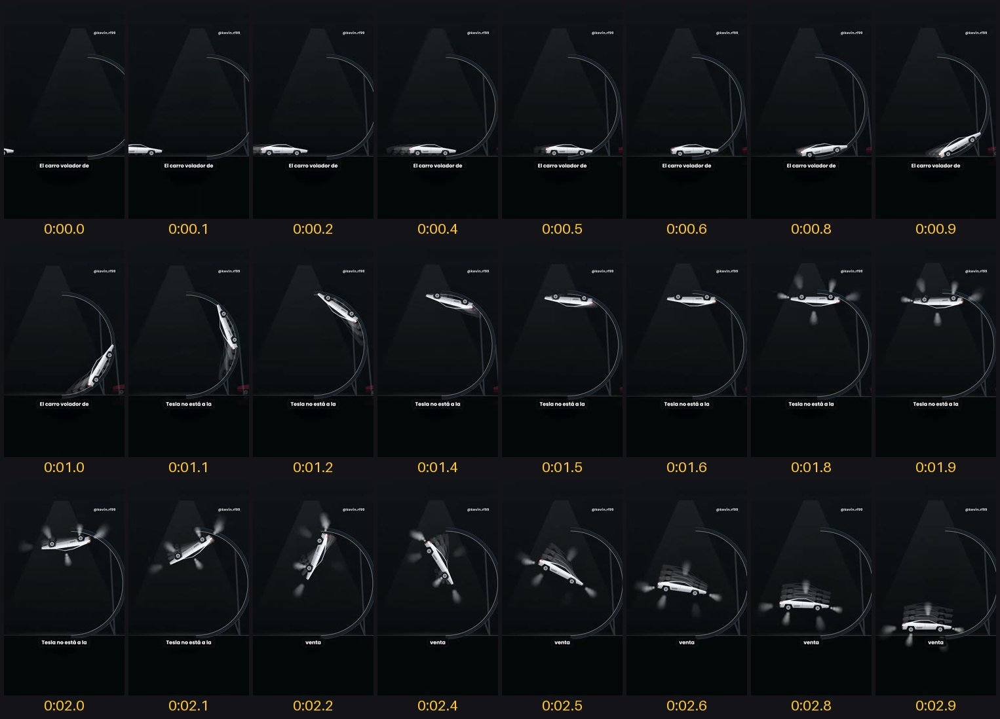

# Ver vídeos

**Le mandas un vídeo a Claude y dice que no puede verlo. Con esto, sí.** Le pasas el enlace de un Reel, un TikTok o un vídeo
de YouTube (o uno tuyo) y lo ve entero. Te lo explica segundo a segundo: el gancho, cada corte, lo que se dice y por qué
funciona. Y te da ideas para hacer uno como ese.



- **Gratis** y de código abierto (MIT).
- **Corre en tu computadora**: el vídeo no se sube a ningún sitio.
- Mac, Windows y Linux.

Hecho por **Kevin Remón** · Instagram [@kevin.rf99](https://www.instagram.com/kevin.rf99/)

---

## Instalarlo (una vez)

1. Abre **Claude** en tu computadora, en la pestaña **Code** (en la pestaña Chat no funciona). Te vale cualquier carpeta.
2. Pégale esto:
   ```
   Instala la skill de github.com/remonkevin99-collab/ver-video en mi carpeta de skills, con todo lo que necesite para funcionar
   ```
3. **Claude te irá pidiendo permiso** para descargar e instalar lo que hace falta (Python y el modelo de voz): dale a
   Permitir. Solo pasa la primera vez.
4. Cuando te diga que terminó, cierra Claude y vuelve a abrirlo.

## Usarlo

En Claude, en la pestaña **Code**, pégale el enlace y dile qué quieres:

```
Analiza este Reel: https://www.instagram.com/reel/...
```
```
¿Por qué funcionó este vídeo? https://www.tiktok.com/@.../video/...
```
```
Tengo una panadería. Dame 3 ideas para hacer un Reel como este: https://www.instagram.com/reel/...
```

O arrastra un vídeo tuyo a la caja donde escribes y pídele que lo vea.

Claude va contando lo que ve mientras lo mira. Al final te da:
- el gancho;
- el vídeo bloque a bloque;
- el ritmo;
- por qué funciona y qué tiene flojo;
- ideas para hacer el tuyo con la misma forma y tus palabras.

## Lo que hace por dentro

1. Baja el vídeo (con [yt-dlp](https://github.com/yt-dlp/yt-dlp)), sin entrar en ninguna cuenta.
2. Saca los cuadros en hojas, cada uno con su segundo:
   - los 3 primeros, 8 por segundo;
   - el resto, uno cada medio segundo en un Reel.
3. Escribe lo que se dice, con su segundo ([faster-whisper](https://github.com/SYSTRAN/faster-whisper), en tu computadora).
4. Cuenta los cambios de plano y junta los datos de la publicación.
5. Claude lo lee todo y te lo explica.

Lo deja en la carpeta `videos-vistos/`. Puedes borrarla cuando quieras.

## Lo que no puede

- **Vídeos privados**, de cuentas privadas, historias y publicaciones de fotos.
- **La música y los efectos de sonido:** solo tiene la voz, escrita.
- **Las vistas de Instagram:** Instagram no las da sin entrar en una cuenta (los Me gusta y los comentarios, sí). TikTok y
  YouTube, sí.
- Si una plataforma cambia y un vídeo público deja de bajar, pídele a Claude: «actualiza yt-dlp de la skill ver-video».

**Es para estudiar vídeos públicos, no para volver a subir el de otro.**
